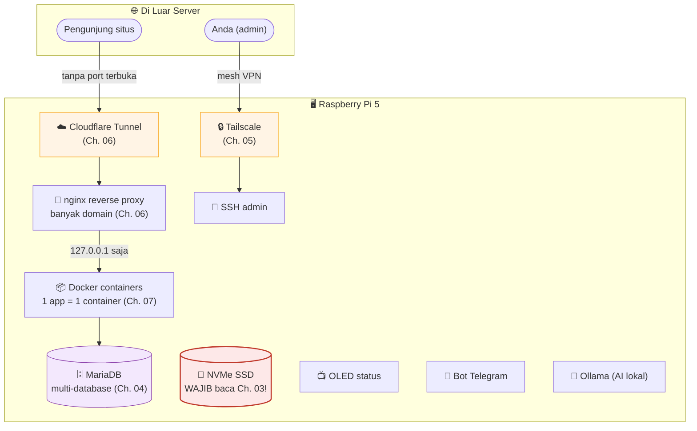

# 00 — Pengantar (Introduction)

> **Untuk siapa tutorial ini**: siapa pun yang ingin punya server sendiri
> di rumah — entah baru mulai belajar Linux, atau sudah senior tapi belum
> pernah pegang Raspberry Pi buat beban produksi sungguhan. Tiap chapter
> punya bagian **Quick Start** (copy-paste, langsung jalan) dan
> **Kenapa Begini** (paham akar masalah, bukan cuma ikut langkah).

## TL;DR

Tutorial ini mendokumentasikan cara membangun 1 server rumahan (Raspberry
Pi 5) yang menjalankan banyak aplikasi web produksi, bot, database, dan
sistem monitoring — dengan reliabilitas kelas industri, bukan cuma
"proyek hobi yang untung-untungan". Semua berdasarkan pengalaman nyata,
termasuk insiden yang benar-benar terjadi dan cara memulihkannya.

Kalau Anda cuma ingin tahu urutan baca yang disarankan:

1. Chapter 01–02: siapkan hardware, install OS.
2. Chapter 03: **WAJIB dibaca sebelum pakai NVMe SSD** — ini bab paling
   kritis di seluruh tutorial.
3. Chapter 04–07: database, remote access, reverse proxy, Docker.
4. Chapter 08–13: fitur tambahan (display, alert, AI lokal, backup,
   keamanan, cara kerja operasional).
5. Chapter 99: baca ini kalau Anda suka cerita horor teknis yang berakhir
   baik — dan supaya Anda tidak mengulang kesalahan yang sama.

## Kenapa Begini

### Kenapa server rumahan, bukan VPS/cloud?

Ini bukan klaim "cloud itu buruk" — cloud punya tempatnya sendiri. Tapi
ada alasan valid untuk server rumahan:

- **Biaya tetap, bukan per-jam/per-request.** Sekali beli hardware,
  selesai — tidak ada tagihan bulanan yang naik seiring traffic.
- **Kontrol penuh** atas storage, jaringan, dan setiap layer di
  bawahnya — bagus untuk belajar, dan bagus untuk kasus yang butuh
  kepatuhan data-tetap-di-tempat.
- **Belajar jauh lebih dalam.** Di VPS, "disk lambat" biasanya cukup
  di-upgrade tier. Di server fisik sendiri, Anda akan benar-benar
  memahami kenapa disk lambat — dan itu (secara mengejutkan) sangat
  berguna, lihat Chapter 03.

Trade-off yang harus diterima dengan sadar: **Anda bertanggung jawab
penuh atas uptime, keamanan, dan pemulihan bencana.** Tidak ada tombol
"restore snapshot" otomatis dari provider. Tutorial ini ada supaya Anda
tidak menghadapi itu sendirian dari nol.

### Apa yang server ini jalankan (digeneralisasi)

Server aslinya menjalankan:
- Beberapa aplikasi web produksi (framework PHP/Laravel, WordPress, dan
  Node.js/React) — di tutorial ini disebut generik **App A, App B, App C**.
- Beberapa bot Telegram sebagai layanan latar belakang.
- 1 instance MariaDB dengan banyak database (satu per aplikasi).
- Sistem monitoring + alert Telegram otomatis.
- AI lokal (Ollama) untuk analisis/ringkasan ringan tanpa panggil API
  cloud.
- Layar OLED kecil yang menampilkan status sistem secara fisik.

Semua di **satu papan Raspberry Pi 5**, bukan cluster, bukan banyak
mesin. Itulah kenapa reliabilitas jadi isu nyata — tidak ada failover
ke mesin lain kalau sesuatu rusak, jadi setiap layer harus benar-benar
dirancang supaya gagal dengan aman (atau tidak gagal sama sekali).

### Arsitektur besar

Setiap kotak di diagram ini punya chapter sendiri. Diagram ini akan
terus dirujuk sepanjang tutorial supaya Anda tidak kehilangan gambaran
besar di tengah detail teknis. Kotak **NVMe SSD** sengaja ditandai
merah — itu komponen yang paling banyak menyebabkan masalah kalau
tidak dikonfigurasi benar (Chapter 03).

### Filosofi "dua kedalaman" di tiap chapter

Kebanyakan tutorial menulis untuk SATU jenis pembaca — biasanya pemula,
sehingga orang yang sudah paham dasar merasa dokumentasinya dangkal dan
tidak menjelaskan "kenapa". Di sini, tiap chapter selalu punya dua
bagian:

- **Quick Start** — kalau Anda cuma butuh sesuatu berjalan sekarang,
  ikuti ini, copy-paste command-nya.
- **Kenapa Begini** — kalau Anda ingin paham akar masalah, apa yang
  terjadi kalau salah konfigurasi, dan bagaimana mendiagnosis kalau
  suatu hari ini rusak. Bagian ini yang membuat Anda bisa memperbaiki
  masalah SENDIRI nanti, bukan cuma menjalankan ulang tutorial dari
  awal.

### Kejujuran soal kegagalan

Bagian yang paling jarang ada di tutorial lain: **server ini pernah
benar-benar rusak**, lebih dari sekali. Bukan disembunyikan — justru
didokumentasikan detail di Chapter 99, karena itulah pengetahuan paling
berharga yang tidak bisa didapat dari dokumentasi resmi mana pun.
Insiden itu termasuk: SSD freeze permanen di tengah beban tulis, dan
filesystem corrupt berantai pasca mati listrik yang menghilangkan
konfigurasi jaringan, crontab, dan membuat layar boot cuma menampilkan
kursor berkedip. Semua itu ada solusinya, dan solusinya ada di tutorial
ini.

## Lanjut ke

➡️ [Chapter 01 — Hardware & Persiapan](../01-hardware-persiapan/)
