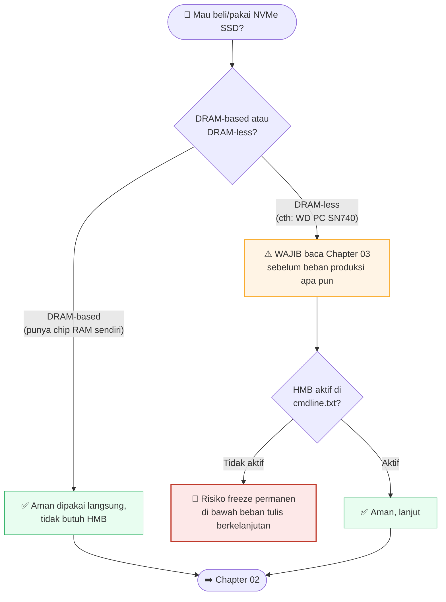

# 01 — Hardware & Persiapan (Hardware & Preparation)

## Quick Start

Daftar belanja minimum untuk mengikuti seluruh tutorial ini:

| Komponen | Rekomendasi | Kenapa |
|---|---|---|
| Raspberry Pi 5 | **8GB RAM** (bukan 4GB) | Menjalankan banyak container Docker + MariaDB + AI lokal sekaligus butuh headroom RAM nyata |
| Storage boot | microSD **hanya untuk instalasi awal** | Nanti dipindah ke NVMe — jangan jadikan SD card storage permanen untuk beban produksi |
| Storage utama | NVMe SSD via HAT (M.2 HAT resmi/kompatibel) | Jauh lebih cepat & tahan lama dari SD card, TAPI baca peringatan di bawah |
| Case + kipas aktif | Wajib, bukan opsional | RPi5 di bawah beban penuh (compile, banyak container) bisa throttle tanpa pendinginan aktif |
| PSU resmi 27W (5V/5A USB-C) | Jangan pakai charger HP biasa | Under-voltage yang tidak terdeteksi = korupsi data yang sulit didiagnosis |
| Layar OLED kecil (I2C, SSD1306 128x64 umum) | Opsional, tapi dipakai di Chapter 08 | Status server sekilas tanpa perlu SSH |
| **UPS (Uninterruptible Power Supply)** | **Sangat disarankan** | Lihat bagian jujur di bawah — ini gap yang ada di server asli |

## Kenapa Begini

### ⚠️ PERINGATAN PALING PENTING: NVMe SSD "DRAM-less"

Ini peringatan yang paling ingin kami sampaikan dari seluruh tutorial
ini, dan alasan Chapter 03 ada sebagai bab tersendiri yang cukup
panjang.

SSD NVMe terbagi jadi dua jenis besar:
- **DRAM-based**: punya chip RAM sendiri di SSD untuk menyimpan tabel
  pemetaan data (FTL — Flash Translation Layer).
- **DRAM-less**: tidak punya RAM sendiri. Untuk kompensasi, ia minta
  sepotong RAM dari sistem host lewat fitur bernama **Host Memory
  Buffer (HMB)**.

Kalau HMB **tidak aktif** (dan di Raspberry Pi 5, firmware-nya bisa
menonaktifkan HMB secara diam-diam), SSD DRAM-less akan mencoba
menyimpan tabel pemetaannya balik ke NAND flash setiap kali — dan
di bawah beban tulis yang berkelanjutan (misalnya restore database,
replay journal filesystem pasca-crash, atau banyak service start
bersamaan saat boot), latensi ini bisa melewati batas timeout
controller. Hasilnya: **controller SSD reset, atau freeze permanen.**

Contoh nyata: WD PC SN740 (drive yang dipakai server ini) adalah
DRAM-less. Server ini pernah benar-benar freeze total karena ini —
detail lengkap kronologinya, cara mendiagnosis, dan parameter boot
yang wajib ada untuk mengaktifkan HMB, semuanya di **Chapter 03**.
Jangan lewati bab itu kalau Anda berencana pakai NVMe SSD apa pun di
Raspberry Pi.

**Cara cepat cek SSD Anda DRAM-less atau bukan sebelum beli**: cari
spesifikasi resmi drive di web produsen, atau cek review/teardown —
biasanya disebutkan eksplisit "DRAM-less" atau "HMB-based". SSD
DRAM-less umumnya lebih murah, itu godaan utamanya.

### PSU: kenapa tidak boleh sembarangan

Raspberry Pi 5 butuh 5V/5A (27W) lewat USB-C. Charger HP biasa sering
hanya mendukung 5V/3A atau kurang di bawah beban, dan Raspberry Pi OS
punya deteksi under-voltage — tapi **deteksi itu tidak selalu sempurna**,
terutama di bawah beban I/O berat (NVMe + banyak container). Under-
voltage yang lolos dari deteksi bisa menyebabkan korupsi data yang
terlihat seperti "bug software acak" padahal akar masalahnya di listrik.

### Case & pendinginan

RPi5 tanpa pendinginan aktif akan throttle CPU di bawah beban
berkelanjutan (compile, restore database besar, scan antivirus). Untuk
server yang harus tetap responsif 24/7, kipas aktif bukan kemewahan.

### Kejujuran soal UPS — gap yang belum kami tutup

Server nyata di belakang tutorial ini **belum punya UPS** sampai saat
tulisan ini dibuat. Ini bukan rekomendasi — ini pengakuan. Pemicu
insiden besar yang diceritakan di Chapter 99 adalah **mati listrik
mendadak**, dan tanpa UPS, kejadian serupa bisa terulang kapan saja.

Kalau Anda menyiapkan server baru dari nol dan punya budget lebih,
belilah UPS kecil (bahkan UPS rumahan biasa yang bisa memberi beberapa
menit waktu untuk graceful shutdown sudah jauh lebih baik daripada
tidak ada sama sekali). Kami menuliskan ini apa adanya supaya Anda
tidak mengulang gap yang sama — pelajari dari kesalahan kami, jangan
dari kesalahan Anda sendiri.

### Layar OLED — kenapa opsional tapi direkomendasikan

Layar kecil I2C (umumnya SSD1306, 128x64 piksel, ~$3-5) yang menampilkan
CPU/RAM/suhu/status container secara fisik. Manfaatnya: Anda bisa lihat
kondisi server sekilas tanpa perlu buka laptop/SSH — penting terutama
saat server ada di ruangan lain atau lagi troubleshooting masalah
jaringan (kalau jaringan mati, SSH juga mati, tapi layar OLED yang
terhubung langsung ke GPIO tetap bisa baca status lokal). Detail wiring
dan skrip di **Chapter 08**.

## Checklist sebelum lanjut ke Chapter 02

- [ ] Raspberry Pi 5 (8GB) sudah di tangan
- [ ] PSU resmi 27W USB-C (bukan charger HP)
- [ ] Case + kipas aktif terpasang
- [ ] microSD card (buat instalasi awal saja) + card reader
- [ ] NVMe HAT + SSD — **sudah dicek dulu apakah DRAM-based atau DRAM-less**
      (kalau DRAM-less, tetap bisa dipakai, tapi WAJIB baca Chapter 03
      sebelum menaruh beban produksi apa pun di atasnya)
- [ ] (Opsional) Layar OLED I2C
- [ ] (Sangat disarankan) UPS

## Lanjut ke

➡️ [Chapter 02 — Instalasi OS & Setup Dasar](../02-instalasi-os-dasar/)

⬅️ [Chapter 00 — Pengantar](../00-pengantar/)
