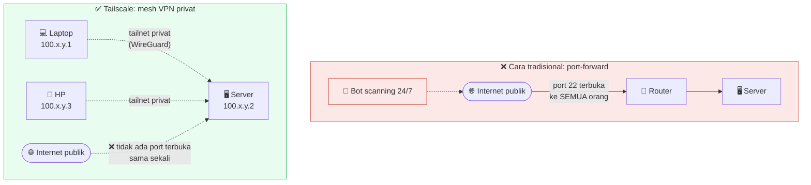

# 05 — Remote Access: Tailscale

## Quick Start

**1. Install &amp; join tailnet:**

```bash
curl -fsSL https://tailscale.com/install.sh | sh
sudo tailscale up
```

Ikuti link autentikasi yang muncul di terminal, login dengan akun Anda
(Google/Microsoft/GitHub/email). Setelah itu, jalankan `tailscale
status` untuk melihat IP Tailscale server Anda (format `100.x.y.z`).

**2. Install juga di perangkat yang akan Anda pakai untuk akses**
(laptop, HP) — download dari [tailscale.com/download](https://tailscale.com/download),
login dengan akun yang sama.

**3. Sekarang Anda bisa SSH dari perangkat mana pun di tailnet Anda,
dari mana pun di internet, tanpa port-forward apa pun di router:**

```bash
ssh pi@100.x.y.z    # IP Tailscale server Anda
```

**4. Perketat UFW agar SSH hanya bisa diakses dari LAN + Tailscale**
(bukan dari IP publik mana pun):

```bash
sudo ufw allow from 192.168.1.0/24 to any port 22   # ganti dgn subnet LAN Anda
sudo ufw allow from 100.64.0.0/10 to any port 22    # rentang CGNAT Tailscale
sudo ufw delete allow 22/tcp                         # hapus rule "allow dari mana pun" dari Chapter 02
```

## Kenapa Begini

### Kenapa mesh VPN, bukan port-forward router biasa



Cara "tradisional" mengakses server rumahan dari luar adalah
port-forward di router (buka port 22 dari internet ke IP lokal server
Anda). Ini punya masalah mendasar: **port itu benar-benar terbuka ke
seluruh internet**, dan langsung menjadi target scanning otomatis
24/7 (bot yang terus-menerus mencoba kombinasi username/password di
seluruh rentang IP publik).

Tailscale (dibangun di atas protokol WireGuard) bekerja berbeda:
perangkat Anda (server dan laptop/HP Anda) bergabung ke **tailnet**
privat, dan saling terhubung lewat **mesh** — setiap perangkat punya
alamat IP privat tetap (`100.x.y.z`, dari rentang CGNAT khusus) yang
HANYA bisa diakses oleh perangkat lain yang juga login ke tailnet yang
sama. Tidak ada port yang perlu dibuka ke internet publik sama sekali.

### Koneksi langsung (direct) vs relay (DERP) — dan kenapa ini penting untuk didiagnosis

Tailscale berusaha membuat koneksi **langsung** (peer-to-peer) antar
perangkat lewat teknik NAT traversal. Tapi tidak semua kombinasi
jaringan mendukung ini (misalnya kalau salah satu sisi di belakang
**symmetric NAT**) — kalau koneksi langsung gagal terbentuk, Tailscale
otomatis jatuh ke **DERP relay** (server relay milik Tailscale,
tersebar di berbagai region) sebagai jalur cadangan.

Koneksi lewat relay tetap terenkripsi end-to-end dan tetap bekerja,
tapi punya sedikit lebih banyak latensi. Yang lebih penting untuk
didiagnosis: **kalau koneksi relay sedang tidak stabil (sering
renegosiasi ulang)**, ini bisa menyebabkan efek samping tidak terduga
di layer di atasnya — misalnya SSH gagal login karena `LoginGraceTime`
(defaultnya cukup singkat, 30-60 detik) habis di tengah proses
autentikasi kalau jalur relay sedang bermasalah persis di momen itu.

Cara diagnosis cepat:

```bash
tailscale ping <ip-tujuan>
# "direct connection not established" = lewat relay, bukan P2P
# lihat juga: tailscale netcheck   -> latensi ke tiap DERP region
```

Kalau Anda menemukan koneksi SSH yang timeout secara sporadis (bukan
selalu, cuma kadang), dan server Anda sendiri terbukti sehat (service
aktif, firewall benar), **cek stabilitas jalur Tailscale** sebelum
menyalahkan hal lain — cek `journalctl -u tailscaled` di sekitar waktu
kejadian, cari pola `magicsock: new contact` yang berulang terlalu
sering (harusnya sekali per beberapa puluh detik dalam kondisi stabil,
bukan setiap 5 detik).

### SSH di port custom (bukan cuma 22) — jebakan fail2ban yang sering terlewat

Kalau Anda menjalankan sshd di lebih dari satu port (misalnya 22 DAN
2222, sebagai jalur cadangan), **pastikan `fail2ban` mem-blokir IP di
KEDUA port itu**, bukan cuma port default. Konfigurasi default
`jail.local` biasanya:

```ini
[sshd]
enabled  = true
port     = ssh          # <- ini HANYA berarti port 22!
```

Kalau Anda menambah port SSH kedua tapi lupa update baris `port` ini,
fail2ban tetap **mendeteksi** percobaan gagal login di port manapun
(karena filternya membaca log auth secara umum), tapi ban yang
dihasilkan **hanya berlaku di port 22** — attacker yang sama tetap bisa
lanjut mencoba tanpa halangan di port satunya. Perbaikannya:

```ini
port     = ssh,2222
```

Setelah restart fail2ban, **verifikasi nyata** (jangan cuma percaya
config-nya benar) dengan mem-ban IP uji dari rentang dokumentasi
`TEST-NET-3` (`203.0.113.0/24`, RFC 5737 — dijamin tidak akan pernah
jadi IP asli siapa pun) lalu cek rule firewall yang terbentuk:

```bash
sudo fail2ban-client set sshd banip 203.0.113.99
sudo nft list ruleset | grep -A3 "sshd"   # harus muncul: tcp dport { 22, 2222 }
sudo fail2ban-client set sshd unbanip 203.0.113.99   # bersihkan lagi
```

### ACL Tailscale (opsional, tapi disarankan kalau banyak device)

Tailscale mendukung **ACL** (Access Control List) lewat admin console
mereka — Anda bisa membatasi perangkat mana yang boleh mengakses
server mana, di port berapa, bukan cuma "semua device di tailnet bisa
akses semua device lain" (default). Untuk server rumahan dengan
sedikit device, default ini biasanya cukup aman; untuk setup yang lebih
besar (banyak anggota tim/keluarga di tailnet yang sama), ACL jadi
penting.

## Checklist sebelum lanjut

- [ ] Tailscale terinstall &amp; join tailnet di server DAN di
      perangkat yang akan Anda pakai untuk akses
- [ ] SSH bisa diakses lewat IP Tailscale dari luar LAN
- [ ] UFW sudah diperketat: SSH cuma dari LAN + rentang Tailscale,
      bukan dari IP publik mana pun
- [ ] Kalau Anda pakai SSH di lebih dari satu port, fail2ban sudah
      dikonfirmasi cover SEMUA port itu (bukan cuma dibaca dari config,
      diverifikasi nyata pakai IP uji)

## Lanjut ke

➡️ [Chapter 06 — Reverse Proxy &amp; Cloudflare Tunnel](../06-reverse-proxy-cloudflare-tunnel/)

⬅️ [Chapter 04 — Database Arsitektur](../04-database-arsitektur/)
