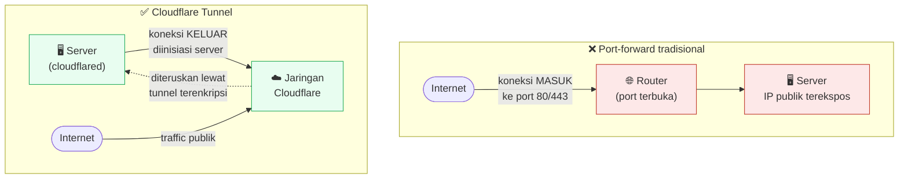

# 06 — Reverse Proxy & Cloudflare Tunnel

## Quick Start

**1. Install nginx, buat satu file config per situs/aplikasi:**

```bash
sudo apt install nginx -y
sudo nano /etc/nginx/sites-available/app-a
```

```nginx
server {
    listen 127.0.0.1:8080;   # port internal, TIDAK diekspos langsung ke luar
    server_name app-a.example.com;

    location / {
        proxy_pass http://127.0.0.1:3001;   # port container Docker App A
        proxy_set_header Host $host;
        proxy_set_header X-Real-IP $remote_addr;
        proxy_set_header X-Forwarded-For $proxy_add_x_forwarded_for;
        proxy_set_header X-Forwarded-Proto $scheme;
    }
}
```

```bash
sudo ln -s /etc/nginx/sites-available/app-a /etc/nginx/sites-enabled/
sudo nginx -t && sudo systemctl reload nginx
```

**2. Install `cloudflared`, buat tunnel lewat dashboard Cloudflare Zero
Trust** (Networks → Tunnels → Create a tunnel), lalu jalankan sebagai
service:

```bash
curl -L https://pkg.cloudflare.com/cloudflared-stable-linux-arm64.deb -o cloudflared.deb
sudo dpkg -i cloudflared.deb
sudo cloudflared service install <TOKEN_DARI_DASHBOARD_ANDA>
```

**3. Di dashboard Cloudflare, atur Public Hostname untuk tunnel itu:**
`app-a.example.com` → `http://localhost:8080` (port internal nginx di
atas). Selesai — **tidak ada port apa pun yang perlu dibuka di router
Anda.**

## Kenapa Begini

### Kenapa nginx sebagai reverse proxy, bukan expose tiap aplikasi langsung

Dengan banyak aplikasi berjalan di server yang sama (masing-masing di
container Docker terpisah dengan port internal berbeda — detail di
Chapter 07), nginx berfungsi sebagai **satu pintu masuk** yang
merutekan request berdasarkan domain/hostname ke aplikasi yang tepat.
Manfaatnya bukan cuma kerapihan: nginx juga jadi tempat terpusat untuk
menangani TLS/SSL, rate-limiting, header keamanan, dan logging —
sekali setup, berlaku untuk semua aplikasi di baliknya.

### Kenapa Cloudflare Tunnel, bukan port-forward + TLS certificate manual

Pendekatan tradisional expose server ke internet: buka port 80/443 di
router (port-forward), lalu urus sertifikat TLS sendiri (Let's Encrypt
+ renewal otomatis). Ini bekerja, tapi:

- Port 80/443 Anda **benar-benar terbuka ke internet**, jadi target
  scanning otomatis terus-menerus (sama seperti masalah port-forward
  SSH di Chapter 05).
- Anda bertanggung jawab penuh atas rotasi sertifikat, DDoS mitigation
  dasar, dan expose IP publik rumah Anda secara langsung ke pengunjung
  situs (yang berarti alamat IP rumah Anda bisa dilacak dari
  domain Anda).

**Cloudflare Tunnel** membalik modelnya: `cloudflared` (proses kecil di
server Anda) membuat **koneksi keluar** ke jaringan Cloudflare (bukan
menunggu koneksi masuk), dan Cloudflare yang menerima traffic publik
lalu meneruskannya lewat tunnel terenkripsi itu ke server Anda. Hasilnya:



*Perhatikan arah panah: di pendekatan tradisional, router harus
menerima koneksi MASUK (port harus terbuka). Di Cloudflare Tunnel,
server yang memulai koneksi KELUAR — tidak ada port yang perlu
menunggu/menerima apa pun dari internet.*

- **Tidak ada port masuk yang perlu dibuka di router sama sekali** —
  bahkan port 80/443 tidak perlu terbuka ke internet.
- TLS/sertifikat ditangani otomatis oleh Cloudflare di sisi mereka.
- IP rumah/server Anda tidak pernah terekspos langsung ke pengunjung.

### Multi-tunnel untuk multi-domain — dan kenapa dipisah per-service

Kalau Anda punya banyak domain/aplikasi, ada dua pendekatan: **satu
tunnel dengan banyak "Public Hostname"** (satu proses `cloudflared`,
banyak rute), atau **satu tunnel per aplikasi/kelompok aplikasi**
(banyak proses `cloudflared`, masing-masing sebagai systemd service
terpisah). Pendekatan kedua (tunnel terpisah) lebih tahan-gagal:
kalau satu tunnel bermasalah (misalnya token expired atau perlu
restart), **hanya aplikasi di tunnel itu yang terdampak**, bukan semua
domain sekaligus.

Contoh unit systemd per tunnel:

```ini
# /etc/systemd/system/cloudflared-app-a.service
[Unit]
Description=Cloudflare Tunnel App A
After=network.target network-online.target
Wants=network-online.target

[Service]
Type=simple
User=root
EnvironmentFile=/etc/cloudflared/app-a.env   # berisi TUNNEL_TOKEN=... (RAHASIA, jangan commit ke git)
ExecStart=/usr/local/bin/cloudflared --no-autoupdate tunnel run
Restart=on-failure
RestartSec=5s

[Install]
WantedBy=multi-user.target
```

### Landmine nyata: race condition saat boot

Ini pelajaran dari pengalaman langsung, bukan teori: kalau nginx
dikonfigurasi untuk `listen` di alamat IP spesifik (misalnya IP
Tailscale server Anda, bukan `0.0.0.0`/localhost), dan Tailscale
belum sempat dapat alamat IP-nya saat nginx mencoba start di awal boot,
**nginx akan gagal start total** — `bind()` ke alamat yang belum ada
langsung error, dan tanpa penanganan khusus, nginx bisa masuk siklus
"start request repeated too quickly" lalu berhenti dicoba sama sekali.

Ini sama persis terjadi ke `cloudflared`: kalau service-nya cuma
`After=network-online.target` tapi jaringan LAN/Tailscale sendiri belum
benar-benar siap (DNS belum bisa di-resolve, dll), `cloudflared` bisa
gagal berulang kali di awal boot.

**Solusi berlapis yang terbukti bekerja:**

1. Tambahkan retry di systemd (`Restart=on-failure`, `RestartSec=5s`
   seperti contoh di atas) — jangan biarkan satu kali gagal berarti
   selesai selamanya.
2. Untuk nginx yang bind ke IP yang mungkin belum siap, tambahkan
   sysctl:

   ```bash
   echo "net.ipv4.ip_nonlocal_bind = 1" | sudo tee /etc/sysctl.d/99-nginx-nonlocal-bind.conf
   sudo sysctl --system
   ```

   Ini mengizinkan nginx **bind ke alamat yang belum ada** tanpa error
   — begitu alamat itu benar-benar aktif (Tailscale selesai konek),
   nginx otomatis bisa melayani di situ tanpa perlu restart manual.
3. Tambahkan dependency eksplisit di unit systemd nginx/cloudflared:
   `After=tailscaled.service` (kalau relevan) supaya urutan start lebih
   masuk akal, meski tetap butuh lapisan 1 &amp; 2 di atas sebagai jaring
   pengaman karena `After=` cuma menjamin URUTAN start, bukan bahwa
   service yang di-`After`-kan itu SUDAH SIAP sepenuhnya.

## Checklist sebelum lanjut

- [ ] nginx terinstall, minimal 1 situs contoh berhasil di-reverse-proxy
- [ ] `cloudflared` terinstall, minimal 1 tunnel aktif &amp; bisa diakses
      dari internet publik
- [ ] Tidak ada port 80/443 yang di-forward di router (cek settingan
      router Anda — pastikan benar-benar tertutup)
- [ ] Kalau nginx/cloudflared Anda bind ke IP dinamis (Tailscale/DHCP),
      sudah pasang `ip_nonlocal_bind` + retry systemd sebagai jaring
      pengaman race condition boot

## Lanjut ke

➡️ [Chapter 07 — Docker Infrastruktur](../07-docker-infrastruktur/)

⬅️ [Chapter 05 — Remote Access: Tailscale](../05-remote-access-tailscale/)
