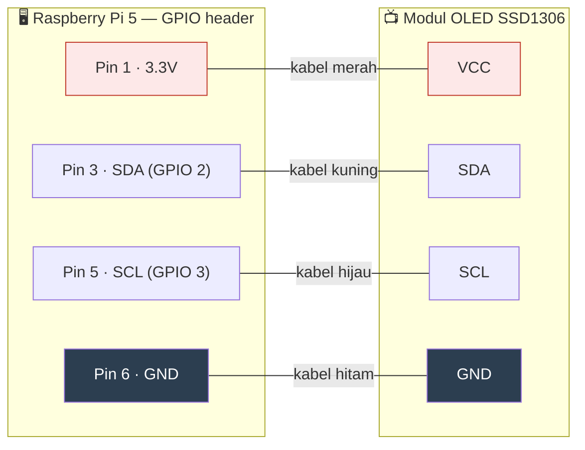

# 08 — LCD OLED Status Display

## Wiring (I2C, 4 kabel)



> 📷 **Catatan jujur**: diagram di atas adalah representasi skematik,
> BUKAN foto wiring asli (kami tidak menyertakan foto hardware fisik
> di draf ini — silakan tambahkan foto asli setup Anda sendiri kalau
> mem-fork tutorial ini). Nomor pin GPIO mengikuti penomoran fisik
> header 40-pin standar Raspberry Pi — cocokkan dengan pinout resmi
> `pinout.xyz` sebelum menyambungkan kabel apa pun, dan **selalu
> matikan Raspberry Pi sebelum menyambung/melepas kabel GPIO**.

## Quick Start

**1. Aktifkan I2C di Raspberry Pi:**

```bash
sudo raspi-config nonint do_i2c 0
sudo reboot
```

**2. Cek layar OLED terdeteksi** (modul SSD1306 128x64 umum dijual
murah, wiring cuma 4 pin: VCC, GND, SDA, SCL):

```bash
sudo apt install i2c-tools -y
i2cdetect -y 1
# Harus muncul alamat device, biasanya 0x3C atau 0x3D
```

**3. Install library Python untuk display:**

```bash
sudo apt install python3-pip python3-pil -y
pip3 install luma.oled --break-system-packages
```

**4. Skrip status sederhana** (`scripts/oled-status.py.example`):

```python
#!/usr/bin/env python3
import time
import psutil
from luma.core.interface.serial import i2c
from luma.oled.device import ssd1306
from luma.core.render import canvas
from PIL import ImageFont

serial = i2c(port=1, address=0x3C)
device = ssd1306(serial, width=128, height=64)
font = ImageFont.load_default()

def get_temp():
    try:
        with open("/sys/class/thermal/thermal_zone0/temp") as f:
            return int(f.read()) / 1000
    except FileNotFoundError:
        return 0.0

while True:
    cpu = psutil.cpu_percent(interval=1)
    ram = psutil.virtual_memory().percent
    temp = get_temp()

    with canvas(device) as draw:
        draw.text((0, 0),  f"CPU : {cpu:5.1f}%", font=font, fill="white")
        draw.text((0, 16), f"RAM : {ram:5.1f}%", font=font, fill="white")
        draw.text((0, 32), f"Suhu: {temp:5.1f} C", font=font, fill="white")
        draw.text((0, 48), time.strftime("%H:%M:%S"), font=font, fill="white")

    time.sleep(4)
```

**5. Jalankan sebagai systemd service** (auto-start, auto-restart kalau
crash):

```ini
# /etc/systemd/system/oled-status.service
[Unit]
Description=OLED Status Display
After=multi-user.target

[Service]
Type=simple
User=<user-anda>
ExecStart=/usr/bin/python3 /path/ke/oled-status.py
Restart=always
RestartSec=5s

[Install]
WantedBy=multi-user.target
```

```bash
sudo systemctl enable --now oled-status.service
```

## Kenapa Begini

### Kenapa layar fisik masih relevan di era SSH/dashboard web

Terdengar kuno di tengah semua dashboard web &amp; SSH yang sudah
dibahas di chapter-chapter sebelumnya, tapi ada satu skenario di mana
layar fisik ini justru satu-satunya yang menyelamatkan: **saat jaringan
itu sendiri yang bermasalah**. Kalau Tailscale/nginx/SSH tidak bisa
diakses karena masalah jaringan (bukan masalah aplikasi), Anda tidak
bisa SSH masuk untuk mendiagnosis — tapi layar OLED yang terhubung
langsung ke GPIO/I2C, dibaca oleh skrip lokal yang berjalan independen
dari stack jaringan, **tetap menampilkan status** (CPU, RAM, suhu,
minimal "sistem masih hidup dan bisa proses"). Ini sering jadi
pembeda antara "server hang total" vs "cuma jaringan yang putus" tanpa
perlu colok monitor/keyboard.

### Kenapa `Restart=always` (bukan `on-failure`) untuk service ini

Skrip Python kecil seperti ini kadang bisa crash karena hal sepele
(exception sesaat saat baca sensor, race condition kecil saat boot
sebelum I2C bus siap). Karena dampaknya kalau mati cuma "layar jadi
kosong" (bukan aplikasi produksi yang terganggu), lebih baik pakai
`Restart=always` yang agresif — auto-restart apa pun penyebab
berhentinya, bukan cuma saat exit code menunjukkan error eksplisit
(`on-failure` tidak selalu menangkap semua skenario mati).

### Jebakan nyata: jangan pakai `sudo` untuk baca data hardware kalau tidak perlu

Pengalaman langsung: skrip status awal memakai `sudo smartctl` untuk
membaca info drive, dengan asumsi butuh akses root. Di lingkungan
non-interaktif (dijalankan sebagai systemd service tanpa TTY), `sudo`
tanpa NOPASSWD yang dikonfigurasi benar akan **gagal secara senyap** —
service tetap "aktif" secara status systemd, tapi datanya salah/kosong
karena command di dalamnya gagal tanpa membuat seluruh service crash
(jadi tidak ada alert, tidak ada tanda jelas ada yang salah).

**Pelajaran**: sebelum menambahkan `sudo` ke skrip yang jalan sebagai
service otomatis, cek dulu **apakah command itu benar-benar butuh
root**. Banyak command monitoring hardware (misalnya `nvme smart-log`
lewat library yang tepat, `/sys/class/thermal/*`, `psutil` untuk
CPU/RAM) bisa diakses tanpa privilege tambahan sama sekali. Kalau
memang butuh root, gunakan **NOPASSWD scoped ke command spesifik** di
`/etc/sudoers.d/` (bukan `NOPASSWD: ALL`) — detail pola ini di
Chapter 12.

### Ekspansi: tampilkan status container, bukan cuma CPU/RAM

Setelah dasar di atas jalan, perluasan alami adalah menampilkan jumlah
container Docker yang `Up` vs total, atau status service kritis
(nginx, database) — cukup panggil `docker ps --format` atau
`systemctl is-active` dari dalam skrip Python (lewat `subprocess`), lalu
render hasilnya di layar bergantian dengan info CPU/RAM.

## Checklist sebelum lanjut

- [ ] I2C aktif, layar terdeteksi di `i2cdetect`
- [ ] Skrip status jalan manual dulu (`python3 oled-status.py`), layar
      menampilkan data yang masuk akal
- [ ] Systemd service terpasang, `enable --now`, dan **terbukti bisa
      auto-restart** kalau skrip di-kill manual (`systemctl status`
      setelah `kill -9 <pid>`, harus balik `active` dalam beberapa detik)
- [ ] Tidak ada `sudo` yang dipakai kecuali benar-benar perlu &amp;
      sudah di-scope NOPASSWD dengan benar

## Lanjut ke

➡️ [Chapter 09 — Monitoring & Auto-Alert Telegram](../09-monitoring-alert-telegram/)

⬅️ [Chapter 07 — Docker Infrastruktur](../07-docker-infrastruktur/)
