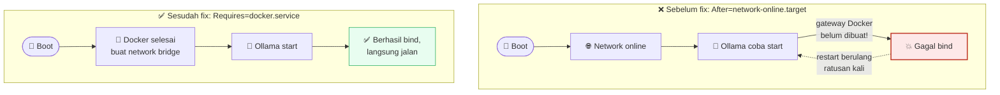

# 10 — AI Lokal (Ollama) — On-device AI

## Quick Start

**1. Install Ollama:**

```bash
curl -fsSL https://ollama.com/install.sh | sh
```

**2. Tarik model kecil yang cocok untuk RAM terbatas Raspberry Pi**
(model 3B-8B parameter, bukan model besar seperti 70B yang butuh
puluhan GB RAM):

```bash
ollama pull llama3.2:3b
# atau model kecil lain sesuai kebutuhan — cek ollama.com/library
```

**3. Test lewat CLI:**

```bash
ollama run llama3.2:3b "Ringkas 3 poin utama dari teks berikut: ..."
```

**4. Panggil dari script/aplikasi lewat API lokal** (Ollama otomatis
jalan sebagai service di `localhost:11434`):

```bash
curl http://localhost:11434/api/generate -d '{
  "model": "llama3.2:3b",
  "prompt": "Ringkas laporan berikut dalam 3 kalimat: ...",
  "stream": false
}'
```

## Kenapa Begini

### Kenapa AI on-device, bukan panggil API cloud (OpenAI/dkk)

Untuk kebutuhan tertentu, menjalankan model kecil langsung di server
sendiri punya keunggulan yang tidak didapat dari API cloud:

- **Privasi** — data (log, laporan internal, apa pun yang Anda proses)
  tidak pernah meninggalkan server Anda.
- **Tanpa biaya per-request** — sekali jalan, tidak ada tagihan API
  yang membengkak seiring volume pemakaian.
- **Tidak bergantung koneksi internet** untuk fitur yang memakainya —
  kalau internet server Anda putus, fitur berbasis AI lokal ini tetap
  bisa jalan (selama servernya sendiri hidup).

### Batasan realistis — jangan berekspektasi setara model besar

Ini bagian kejujuran yang wajib disampaikan: model 3B-8B yang bisa
jalan nyaman di Raspberry Pi **jauh** di bawah kemampuan model besar
seperti GPT-4/Claude/Gemini terbaru. Cocok untuk:
- Ringkasan teks pendek-menengah (laporan harian, log yang sudah
  difilter).
- Klasifikasi/kategorisasi sederhana.
- Draft/analisis awal yang masih akan direview manusia.

**Tidak cocok** untuk: reasoning kompleks, coding non-trivial, atau
apa pun yang butuh akurasi tinggi tanpa review manusia. Contoh
pemakaian nyata yang masuk akal: ringkasan laporan harian otomatis
(status server, aktivitas, dikirim lewat bot Telegram dari Chapter 09)
— tugas yang "cukup baik" sudah bernilai, bukan tugas yang butuh
kesempurnaan.

### Landmine nyata: race condition boot Ollama vs jaringan Docker



Ini pelajaran dari kejadian langsung yang menyebabkan **ratusan kali
restart** dalam log sebelum ditemukan akar masalahnya:

Kalau Ollama dikonfigurasi untuk listen di alamat IP tertentu (misalnya
lewat drop-in systemd `OLLAMA_HOST=<ip-gateway-docker>:11434` — pola
ini kadang dipakai supaya container Docker bisa mengakses Ollama di
host lewat gateway network Docker-nya), dan unit systemd Ollama cuma
punya dependency `After=network-online.target`, maka **saat boot,
Ollama bisa mencoba start SEBELUM Docker daemon benar-benar membuat
network bridge-nya** — alamat gateway Docker itu belum ada sama sekali
di titik itu. Ollama gagal bind, systemd mencoba restart (sesuai
`Restart=` policy), gagal lagi (karena Docker masih belum selesai
inisialisasi), dan siklus ini bisa berulang **ratusan kali** dalam
hitungan detik/menit sebelum akhirnya Docker selesai setup dan Ollama
berhasil start.

**Kenapa ini penting bukan cuma soal kosmetik log**: ratusan restart
dalam waktu singkat adalah beban I/O tulis yang sia-sia — persis di
momen paling rawan bagi storage (lihat Chapter 03 soal kenapa beban
tulis saat boot berbahaya untuk SSD tertentu).

**Perbaikan**: tambahkan dependency eksplisit ke service Docker,
bukan cuma jaringan umum:

```ini
# drop-in: /etc/systemd/system/ollama.service.d/override.conf
[Unit]
After=docker.service
Requires=docker.service
```

```bash
sudo systemctl daemon-reload
sudo systemctl restart ollama
```

Ini memastikan systemd menunggu Docker (dan network bridge-nya) benar-
benar siap SEBELUM mencoba start Ollama, bukan sekadar berharap
`network-online.target` generik itu cukup.

**Pelajaran umum di balik kasus spesifik ini**: kalau service A butuh
sesuatu yang disediakan oleh service B (bukan cuma "jaringan secara
umum sudah hidup"), nyatakan dependency itu eksplisit
(`After=`/`Requires=` ke nama service B, bukan ke target generik).
Target generik seperti `network-online.target` cuma menjamin "kartu
jaringan sudah dapat IP", bukan "semua service yang Anda butuhkan
sudah selesai inisialisasi".

### Contoh pemakaian: ringkasan laporan harian otomatis

Gabungkan dengan cron + script sederhana: kumpulkan data (status
server, ringkasan log, angka-angka dari health-check), susun jadi
prompt, kirim ke Ollama lokal, ambil hasilnya, kirim lewat bot Telegram
dari Chapter 09 — semuanya tanpa satu pun panggilan ke API eksternal.

## Checklist sebelum lanjut

- [ ] Ollama terinstall, model kecil (3B-8B) berhasil ditarik &amp;
      dites lewat CLI
- [ ] API lokal (`localhost:11434`) bisa dipanggil dari script/aplikasi
      lain
- [ ] Kalau Ollama perlu diakses dari container Docker (bukan cuma
      dari host), dependency systemd terhadap `docker.service` sudah
      benar (bukan cuma `network-online.target`) — cek `journalctl -u
      ollama` tidak menunjukkan restart berulang saat boot

## Lanjut ke

➡️ [Chapter 11 — Strategi Backup Berlapis](../11-backup-strategi-4-lapis/)

⬅️ [Chapter 09 — Monitoring & Auto-Alert Telegram](../09-monitoring-alert-telegram/)
