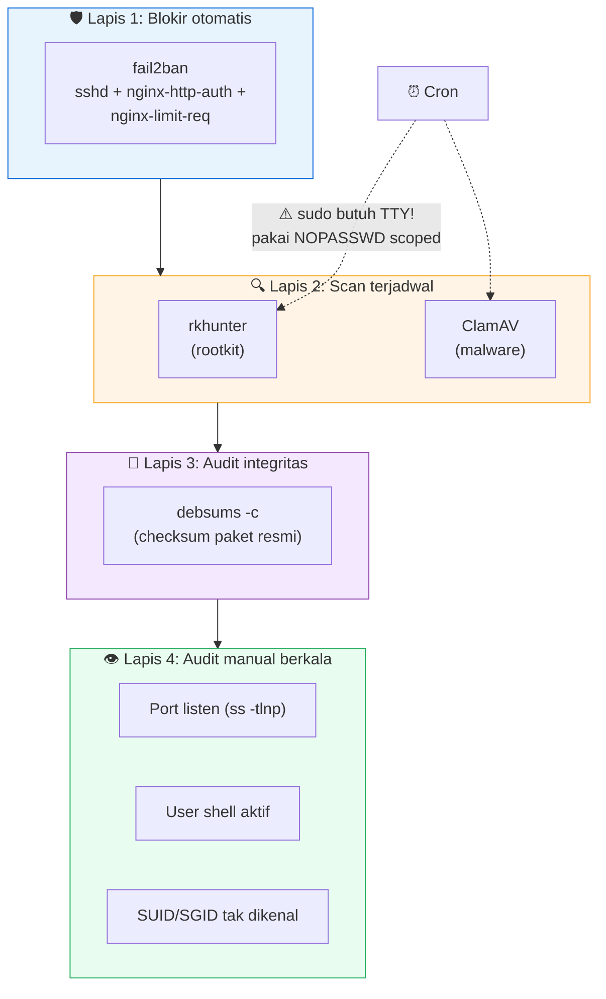

# 12 — Keamanan Lanjutan (Advanced Hardening)



## Quick Start

**1. fail2ban multi-jail** (`/etc/fail2ban/jail.local`):

```ini
[sshd]
enabled  = true
port     = ssh          # ganti jadi "ssh,2222" kalau Anda punya SSH port kedua (lihat Chapter 05)
logpath  = /var/log/auth.log
maxretry = 3
bantime  = 24h

[nginx-http-auth]
enabled  = true
filter   = nginx-http-auth
logpath  = /var/log/nginx/error.log
maxretry = 5

[nginx-limit-req]
enabled  = true
filter   = nginx-limit-req
logpath  = /var/log/nginx/error.log
maxretry = 5
```

```bash
sudo systemctl restart fail2ban
sudo fail2ban-client status   # cek semua jail "enabled" dan aktif
```

**2. rkhunter &amp; ClamAV terjadwal** — install, lalu **baca peringatan
di bawah soal cron+sudo sebelum menjadwalkan**:

```bash
sudo apt install rkhunter clamav clamav-daemon -y
```

**3. `debsums` untuk audit integritas paket:**

```bash
sudo apt install debsums -y
sudo debsums -c   # tampilkan file yang checksum-nya TIDAK cocok dengan paket resmi
```

## Kenapa Begini

### fail2ban — verifikasi nyata, jangan cuma percaya config

Sudah dibahas sekilas di Chapter 05: config yang "terlihat benar" tidak
selalu berarti **enforcement nyata terjadi**. Kebiasaan yang wajib
dibangun: setiap kali mengubah config keamanan seperti ini, **uji
dengan aksi nyata**, bukan cuma baca ulang file config-nya.

```bash
# Ban IP dari rentang dokumentasi (RFC 5737 TEST-NET-3) — dijamin bukan IP asli siapa pun
sudo fail2ban-client set sshd banip 203.0.113.99

# Verifikasi rule firewall BENAR-BENAR terbentuk
sudo nft list ruleset | grep -A3 sshd
# harus muncul rule reject yang mencakup IP itu, di port yang benar

# Bersihkan lagi
sudo fail2ban-client set sshd unbanip 203.0.113.99
```

Kalau langkah verifikasi ini dilewati, Anda bisa saja punya konfigurasi
yang **terlihat** aman (jail status "enabled", 0 IP di-ban karena
memang belum ada yang perlu di-ban) padahal enforcement sebenarnya
tidak pernah teruji jalan.

### Jebakan universal: cron + `sudo` butuh TTY

Ini salah satu jebakan paling umum &amp; paling sering luput karena
**gagal secara senyap** — tidak membuat sistem crash, cuma membuat
sebuah tugas terjadwal tidak pernah benar-benar berjalan:

```
# crontab yang TERLIHAT benar tapi akan GAGAL:
0 3 * * * sudo rkhunter --check --skip-keypress >> /var/log/rkhunter.log 2>&1
```

`sudo` yang dijalankan dari cron **tidak punya terminal interaktif**
untuk memasukkan password. Hasilnya, log akan berisi baris seperti:

```
sudo: a terminal is required to read the password; either use the -S option to read from standard input or configure an askpass helper
sudo: a password is required
```

**setiap hari, tanpa henti** — dan karena ini bukan error yang membuat
sistem "merah" secara jelas (tidak ada proses crash, tidak ada alert
otomatis kecuali Anda benar-benar membaca isi log), tugas keamanan
terjadwal ini bisa diam-diam tidak pernah berjalan **selama berminggu-
minggu** sebelum ada yang sadar.

**Perbaikan yang benar** — NOPASSWD **scoped ke command spesifik**,
BUKAN `NOPASSWD: ALL` (yang membuka akses root penuh tanpa password,
jauh lebih berbahaya dari masalah yang ingin diselesaikan):

```bash
# /etc/sudoers.d/cron-security-scans  (edit LEWAT visudo, jangan edit langsung)
pi ALL=(ALL) NOPASSWD: /usr/bin/rkhunter --check --skip-keypress
```

Setelah ditambahkan, **validasi syntax sebelum dipakai** (kesalahan
syntax di file sudoers bisa mengunci Anda dari `sudo` sama sekali):

```bash
sudo visudo -c -f /etc/sudoers.d/cron-security-scans
```

Lalu **uji ulang persis seperti yang akan dipanggil cron** — argumen
harus SAMA PERSIS dengan yang ada di crontab, karena sudoers mencocokkan
command line secara eksak (kecuali pakai wildcard eksplisit):

```bash
sudo -n rkhunter --check --skip-keypress
# harus langsung jalan tanpa prompt password
```

### Jebakan kedua: log yang "kosong" tidak selalu berarti "gagal"

Pelajaran yang berlawanan arah dari yang di atas, sama pentingnya:
kalau Anda menjadwalkan `clamscan` dengan flag `--quiet --infected`,
**tidak ada apa pun yang ditulis ke log kalau scan berhasil DAN tidak
ada file terinfeksi** — kedua flag itu memang dirancang untuk diam
kecuali ada temuan. Melihat file log yang mtime-nya "beku" selama
berminggu-minggu **bisa berarti scan berhenti berjalan, TAPI bisa juga
berarti scan berjalan sempurna setiap hari dan memang tidak pernah
menulis apa pun karena selalu bersih**.

**Cara memastikan yang mana** (jangan menyimpulkan dari mtime file log
saja): cek bukti eksekusi yang independen dari isi log, misalnya lewat
`journalctl` untuk memastikan cron benar-benar memanggil command itu:

```bash
sudo journalctl --since "5 days ago" | grep -i "CRON.*clamscan"
# kalau muncul entri tiap hari -> scan BENAR-BENAR jalan, cuma diam karena bersih
```

Ini prinsip umum yang berlaku luas: **jangan simpulkan status sistem
dari satu sinyal tidak langsung (mtime file log) tanpa mengonfirmasi
lewat bukti langsung (log eksekusi proses itu sendiri)**.

### `debsums -c` — audit integritas paket

`debsums` membandingkan checksum file yang terinstall dengan checksum
resmi yang tercatat oleh `dpkg` saat instalasi paket. Ini berguna untuk
mendeteksi:
- File sistem yang berubah tanpa lewat mekanisme paket resmi (indikasi
  potensial tamper/backdoor).
- Kerusakan filesystem tingkat rendah yang mengubah isi file tanpa
  disadari (lihat Chapter 99 untuk kasus nyata).

**Catatan penting supaya tidak salah tafsir hasil**: tidak semua
mismatch berarti masalah. File konfigurasi yang memang sengaja Anda
edit manual (`/etc/nginx/nginx.conf`, dll) WAJAR berbeda dari checksum
paket asli — itu memang tujuan file config. Fokus kecurigaan ke file
**binary/executable** yang mismatch, bukan file config.

### Audit berkala lain yang layak dijadwalkan

- **Port yang listen** (`ss -tlnp`) — bandingkan dengan aturan UFW,
  pastikan tidak ada port yang ter-expose ke `0.0.0.0` tanpa Anda
  sadari (biasanya karena aplikasi baru yang defaultnya bind ke semua
  interface).
- **User dengan shell login aktif** (`awk -F: '$7 !~ /nologin|false/
  {print $1}' /etc/passwd`) — pastikan cuma user yang memang Anda
  kenal, bukan akun service yang seharusnya `nologin` tapi ter-
  konfigurasi salah.
- **SUID/SGID binary tak dikenal** (`find / -xdev -perm -4000 -type f`)
  — cross-check tiap hasil terhadap `dpkg -S <path>` untuk memastikan
  semuanya berasal dari paket resmi, bukan binary asing yang
  ditanamkan diam-diam.

## Checklist sebelum lanjut

- [ ] fail2ban aktif dengan minimal 3 jail (SSH, nginx auth, nginx
      rate-limit), **diverifikasi lewat tes ban+unban nyata**
- [ ] rkhunter &amp; ClamAV terjadwal, dan Anda sudah cek NOPASSWD-nya
      benar-benar bekerja tanpa TTY (bukan cuma diasumsikan)
- [ ] Anda paham kenapa log kosong ClamAV BELUM TENTU berarti scan mati
      — dan tahu cara memastikan lewat `journalctl`
- [ ] `debsums -c` sudah dijalankan minimal sekali, hasil mismatch
      (kalau ada) sudah diperiksa satu-satu

## Lanjut ke

➡️ [Chapter 13 — Operasional & Dokumentasi (AI-assisted)](../13-operasional-dokumentasi-ai-assisted/)

⬅️ [Chapter 11 — Strategi Backup Berlapis](../11-backup-strategi-4-lapis/)
