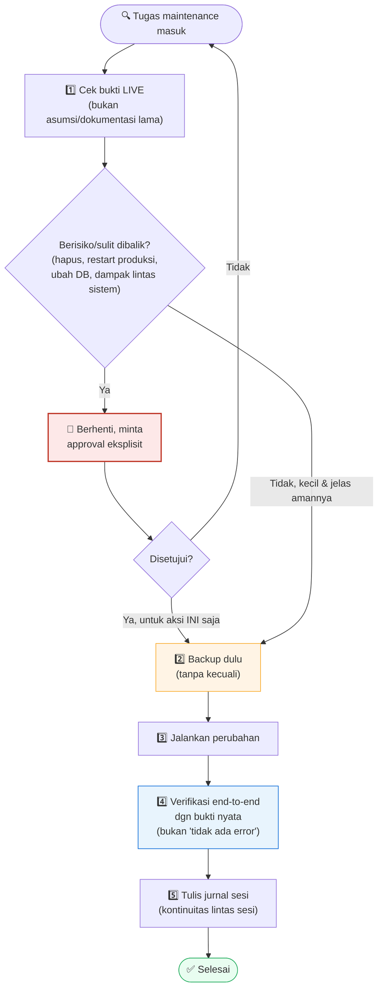

# 13 — Operasional & Dokumentasi (AI-assisted Ops)

> Ini bab yang paling jarang dibahas tutorial homelab lain — soal
> bagaimana menjalankan server dengan disiplin operasional yang
> biasanya cuma ada di tim profesional, meski Anda mengelolanya
> sendirian, dan bagaimana asisten AI bisa membantu tanpa Anda
> kehilangan kendali atas sistem Anda sendiri.

## Quick Start

**1. Struktur dokumentasi minimum per proyek/server:**

```
docs/
├── ARCHITECTURE.md      <- komponen, alur data, dependency antar service
├── DATABASE-SCHEMA.md   <- struktur tabel, relasi (kalau ada database)
├── SECURITY.md          <- auth, penyimpanan rahasia, port exposure
└── BACKUP-POLICY.md     <- rujukan tunggal semua lapisan backup (Chapter 11)
```

**2. Jurnal kerja per sesi maintenance** (`sessions/YYYY-MM-DD-topik.md`):

```markdown
# Sesi 2026-09-11 — <topik singkat>

## Konteks
<kenapa sesi ini ada>

## Dikerjakan
- <perubahan 1>
- <perubahan 2>

## Keputusan
- <keputusan + alasan singkat>

## Backup dibuat
- `<path>.bak-YYYYMMDD` — BOLEH DIHAPUS SETELAH <YYYY-MM-DD>

## Verifikasi
- <hasil tes / status>

## Next step
- <lanjutan>
```

**3. Kalau memakai asisten AI untuk maintenance, aturan dasar yang
wajib ditegakkan** (bisa ditaruh di file instruksi khusus yang dibaca
otomatis tiap sesi, misal `CLAUDE.md` untuk Claude Code):

```markdown
1. JANGAN ubah sistem/config/kode tanpa DUA syarat: (a) bukti kuat dari
   pengecekan LANGSUNG ke sistem live, (b) persetujuan eksplisit Anda.
2. Backup dulu SEBELUM mengubah file/config/DB penting, setiap kali.
3. Verifikasi end-to-end SETELAH perubahan — jangan asumsi berhasil
   dari "tidak ada error".
4. Untuk aksi berisiko/ireversibel: konfirmasi dulu, selalu.
5. Commit ke git tiap perubahan selesai & teruji — TAPI push tetap
   butuh izin terpisah tiap kali.
```

## Kenapa Begini

### Kenapa dokumentasi penting bahkan untuk server pribadi

Alasan paling jujur: **"future you" adalah orang asing yang lupa semua
konteks**. Keputusan yang terasa jelas &amp; mudah diingat hari ini
(kenapa port ini dipilih, kenapa config itu di-tweak begitu) akan
terasa asing 6 bulan lagi ketika Anda perlu mengubahnya lagi dan tidak
ingat alasannya. Dokumentasi bukan formalitas tim besar — ini catatan
untuk diri Anda sendiri di masa depan, yang efeknya sama pentingnya
baik Anda kerja sendirian atau bertim.

### Kenapa jurnal per-sesi, terpisah dari dokumentasi arsitektur

Dokumentasi arsitektur (`ARCHITECTURE.md`, dll) menjawab "bagaimana
sistem ini bekerja SEKARANG" — selalu direvisi supaya tetap akurat
dengan kondisi terkini. Jurnal sesi menjawab pertanyaan berbeda:
**"apa yang terjadi, kapan, dan kenapa diputuskan begitu"** — bersifat
historis, tidak pernah diedit ulang setelah ditulis (kecuali koreksi
faktual). Keduanya saling melengkapi: kalau suatu hari Anda perlu tahu
"kenapa keputusan ini pernah diambil", jurnal sesi yang punya
jawabannya, bukan dokumentasi arsitektur yang sudah ditimpa oleh
perubahan-perubahan berikutnya.

### Kalau memakai asisten AI untuk maintenance — pola yang terbukti aman



Menggunakan asisten AI (seperti Claude Code atau sejenisnya) untuk
membantu maintenance server rumahan bisa sangat produktif, tapi juga
berisiko kalau tidak dipagari dengan aturan jelas. Pola yang terbukti
bekerja dari pengalaman langsung:

1. **Bukti dulu, baru tindakan.** Asisten AI harus mengecek kondisi
   LIVE sistem dulu (lewat command nyata) sebelum mengambil kesimpulan
   atau melakukan perubahan — bukan berasumsi dari dokumentasi lama
   (yang bisa saja sudah tidak akurat) atau dari "biasanya begini".
2. **Backup-first, tanpa kecuali.** Sebelum mengubah file/config/DB
   penting apa pun, backup dulu — bahkan untuk perubahan yang terasa
   kecil/sepele. Biaya membuat backup nyaris nol; biaya tidak punya
   backup saat sesuatu salah bisa sangat besar.
3. **Verifikasi end-to-end setelah perubahan, dengan bukti nyata.**
   "Tidak ada error saat dijalankan" bukan bukti cukup bahwa perbaikan
   benar-benar bekerja. Contoh nyata dari pengalaman: memperbaiki rule
   firewall lalu **benar-benar menguji dengan mem-ban IP dokumentasi
   dan mengecek rule yang terbentuk** — bukan cuma percaya config
   sudah benar karena syntax-nya valid.
4. **Approval eksplisit untuk aksi berisiko**, dan approval itu
   **tidak otomatis meluas** ke aksi lain yang mirip. Izin untuk
   mengubah satu config tidak berarti izin untuk restart service
   produksi lain; izin untuk commit ke git tidak berarti izin untuk
   push ke remote.
5. **Kontinuitas lewat catatan tertulis, bukan "ingatan" sesi chat.**
   Sesi percakapan dengan asisten AI bisa terputus (disconnect, ganti
   perangkat, dll) — jurnal sesi &amp; dokumentasi tertulis adalah
   jaring pengaman supaya konteks kerja tidak hilang total, siapa pun
   (manusia atau AI) yang melanjutkan nanti bisa membaca ulang apa
   yang sudah terjadi.

### Landmine nyata: laporan yang terlihat meyakinkan bisa salah

Bahkan agen otomatis/AI yang tampak kompeten bisa menarik kesimpulan
keliru dari data yang tidak lengkap. Contoh nyata: sebuah audit
otomatis menyimpulkan "layanan antivirus terjadwal sudah mati sejak
sekian minggu" — kesimpulan itu masuk akal dari sudut pandang yang
dilihat (file log yang tidak berubah), tapi ternyata **keliru**
setelah diverifikasi dengan cara berbeda (log eksekusi cron
menunjukkan proses itu berjalan normal setiap hari, cuma tidak
menghasilkan output karena memang tidak ada temuan). **Pelajaran**:
perlakukan laporan/kesimpulan apa pun — dari asisten AI, dari script
otomatis, bahkan dari diri sendiri di masa lalu — sebagai hipotesis
yang perlu diverifikasi ulang untuk temuan besar, bukan fakta final
yang otomatis dipercaya.

### Kapan HARUS berhenti dan bertanya (untuk asisten AI maupun proses otomatis manapun)

- Tindakan yang sulit/tidak bisa dibalik (hapus, force, reset, restart
  service produksi, ubah data di database).
- Bukti yang ditemukan bertentangan dengan asumsi awal / dokumentasi
  yang ada.
- Perubahan yang berdampak ke lebih dari satu sistem/layanan sekaligus.

Kalau semua kondisi di atas tidak terpenuhi (perubahan kecil, mudah
dibalik, dampak terbatas, bukti sudah jelas) — untuk pekerjaan rutin
yang sifatnya sudah dipahami polanya, lanjutkan eksekusi tanpa
menunggu konfirmasi di setiap langkah kecil adalah pilihan yang lebih
produktif daripada berhenti bertanya untuk hal yang sudah jelas
amannya.

## Checklist sebelum lanjut

- [ ] Struktur `docs/` minimum sudah ada (arsitektur, keamanan, backup
      policy)
- [ ] Kebiasaan menulis jurnal sesi setelah maintenance berarti sudah
      berjalan (bukan cuma sesekali)
- [ ] Kalau memakai asisten AI, aturan dasar (backup-first, verifikasi
      live, approval eksplisit untuk aksi berisiko) sudah tertulis di
      tempat yang otomatis terbaca tiap sesi
- [ ] Git commit rutin tiap perubahan selesai &amp; teruji (push tetap
      manual/terpisah)

## Lanjut ke

➡️ [Chapter 99 — Studi Kasus Insiden](../99-studi-kasus-insiden/) — cerita nyata di balik semua peringatan di tutorial ini

⬅️ [Chapter 12 — Keamanan Lanjutan](../12-keamanan-lanjutan/)
